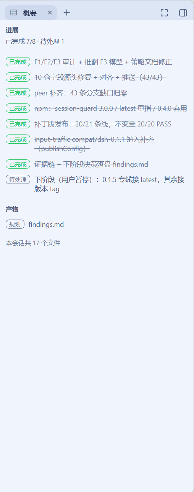

# dsh-brief-sidebar

[简体中文](README.md) | [Français](README.fr.md) | [Deutsch](README.de.md) | [Italiano](README.it.md) | [Русский](README.ru.md) | [Español](README.es.md) | [Português](README.pt.md)

Plugin web para DSH (consumidor do `dsh-better-sidebar`), repositório/nome do pacote **`dsh-brief-sidebar`**
(barra lateral do brief da sessão). Ele renderiza o **brief (resumo)** da sessão como uma aba
«Resumo» na barra lateral direita; o brief é composto por duas listas:

- **Lista de todos** — o quadro de **progresso** da projeção `todos`, com os três estados das
  tarefas da sessão atual e o resumo de avanço;
- **Lista de artefatos** — a seção **Artefatos produzidos** da projeção `dshSummaryDeliverables`,
  que mostra em tempo real, dentro do turno, os arquivos gravados/alterados com sucesso; os
  artefatos de planejamento do codeplan recebem a pill «Planejamento» na própria linha.

Ao mesmo tempo ele **encobre** o painel oficial de todos acima do composer do DSH, de modo que o
quadro passa a ser o único portador visível dos todos.

Exibição somente leitura: nada de edição, nada de gravação de volta, nada de agregação entre
sessões, nada de copiar camada de renderização de terceiros.

**Escopo de compatibilidade**: esta linha (branch `main`, promovida de `compat/0.2.0`) mira a
**linha DSH 0.2.0** — `engines.dsh` é `>=0.1.0-rc.2 <0.3.0-0`, a linha-base testada é o DSH
0.2.0-rc.1 e o lançamento sai pelo dist-tag npm **`dsh-0.2.0`**. O 0.2.0 é acréscimo puro em
relação a toda API do host que este plugin usa (a superfície consumida são callers puros de
`ctx.get(...)`, zero remoção de exportações), então basta adiantar a linha suportada: não existe
ramo de compatibilidade em tempo de execução. **Escolha a versão do plugin pela versão do host DSH**
(não use `latest` nu em hosts antigos — quem não satisfaz o `engines` do host antigo é desativado
em silêncio pela pré-verificação de inicialização; um intervalo caret também não atravessa o minor
do host):

| Host DSH | Versão mais recente do plugin | Dist-tag de instalação |
|---|---|---|
| 0.2.0 | **0.4.0** (latest) | `dsh-0.2.0` |
| 0.1.7 | 0.3.1 | `dsh-0.1.7` |
| 0.1.5 | 0.3.1 | `dsh-0.1.5` |
| 0.1.2 e anteriores | sem suporte (a linha 0.1.x tem 0.1.5-rc.1 como limite inferior; não existe dist-tag correspondente no npm) | — |

(data de 2026-09-30; a linha 0.1.x continua servida pelas branches congeladas `compat/0.1.7` /
`compat/0.1.5` (≤0.3.1).)




**Limite de nomenclatura**: os identificadores de identidade deste plugin (nome do pacote / plugin
id / cordis bundle id / namespace de locale / gancho DOM `data-dsh-brief-sidebar`) usam sempre
`brief`; já a projeção `todos`, a ferramenta `todo_write`, a célula oficial `{ id: 'todo' }` do
dock e o `dsh-tool-todo` pertencem ao domínio upstream do DSH: a palavra original `todo` é
mantida e nada é renomeado por causa deste plugin.

**Memória, referências e eco**: a terceira seção do brief, «Referências», abriga nas suas abas
**Skills / Memória / Buscas / Eco**. Dentro da aba Memória estão as recordações desta sessão e os
slots residentes (cada um com seu interruptor), além de «Detalhes ▾» (Entradas / gráfico 2D /
gráfico 3D; o «Detalhes ▾» da própria linha abre o mesmo menu), que abre por deep link a página
inteira da biblioteca de memória do `dsh-prime-memory`. A aba Eco lê a projeção `spiritEcho` do
`dsh-spirit` e mostra o retrato de injetado/pulado desta sessão, com atalho para
«Mar de memória → Folhear → Eco».

## Mapeamento dos requisitos

| Nº | Requisito | Onde está implementado |
|---|---|---|
| R1 | Durante o montaje do plugin a faixa oficial de todos não é renderizada de jeito nenhum | `src/client/brief/dock-shadow.tsx` |
| R2 | Plugin novo e independente, que registra a aba «Resumo» no better-sidebar | `src/client/index.tsx` |
| R3 | Os dados vêm apenas da projeção `todos` calculada pelo Host, sem dobramento no cliente, sem gravar de volta | `src/client/brief/use-todos.ts` + `board.ts` |
| R4 | React comum + tokens `--dsw-alias-*`, zero relação de código/nomenclatura com o plugin Canvas | `src/client/TodoBoardTab.tsx` (TodoSection) + `BriefIcon.tsx` |
| R5 | Reversível: depois de desativar/desinstalar o plugin, o dock oficial volta sozinho | Todo registro passa por `ctx.effect`; o disposer é recolhido junto com o fiber |
| R6 | Não destrutivo: não mexe no checkout do DSH / better-sidebar / plugin canvas | Este pacote é autossuficiente; nenhum daqueles repositórios foi tocado |
| R7 | A aba vira «Resumo» e o `TAB_ID` não muda (substituição no lugar, abas já abertas não se perdem) | `src/client/SummaryTab.tsx` + `index.tsx` |
| R8 | Seção 1 «Progresso»: o contrato de três estados dos todos desce ao nível da seção | `src/client/TodoBoardTab.tsx` |
| R9 | Seção 2 «Artefatos»: lista em tempo real do turno mais recente + acumulado da sessão; a metade host registra a projeção | `src/projection/*` + `src/client/summary/*` |
| R10 | Os artefatos do codeplan são um subconjunto anotado da seção de artefatos (pill «Planejamento» na linha), não uma seção à parte | `src/client/summary/deliverables.ts` + `DeliverablesSection.tsx` |
| R11 | Seção Referências: quatro abas — Skills / Memória / Buscas / Eco; a aba Memória traz as recordações da sessão + slots residentes (cada um com interruptor) | `src/client/summary/ReferenceSection.tsx` |
| R12 | Comportamento preservado: encobrimento, badge, pausa por `visible`, contrato de altura, adaptação ao 0.1.5 | Em vários pontos, veja adiante |
| R13 | A metade host não faz IO síncrono; a projeção é contribuição opcional (espera via `ctx.inject`) | `src/index.ts` + `src/projection/register.ts` |
| R14 | Aba Eco (dentro de Referências): lê a projeção `spiritEcho` e mostra a contagem da sessão e o nome do último portão de injeção/pulo; «Ver →» faz deep link até o eco no mar de memórias | `src/client/summary/SpiritEchoSection.tsx` + `spirit-open.ts` |
| R15 | «Detalhes ▾» da memória e «Detalhes ▾» da linha: Entradas / 2D / 3D abrem a biblioteca prime-memory pelo deep link `open-explorer` (a linha leva o recordId) | `src/client/summary/MemoryViewMenu.tsx` + `memory-open.ts` |

## Instalação

```powershell
# escolha o dist-tag pela versão do host DSH (recomendado; não use latest nu)
dsh plugin --profile web add dsh-brief-sidebar@dsh-0.2.0   # linha DSH 0.2.0 (0.4.0)
dsh plugin --profile web add dsh-brief-sidebar@dsh-0.1.7   # linha DSH 0.1.7 (0.3.1)
dsh plugin --profile web add dsh-brief-sidebar@dsh-0.1.5   # linha DSH 0.1.5 (0.3.1)
# alternativa 1: tarball local (nesta linha é dsh-brief-sidebar-0.4.0.tgz)
dsh plugin --profile web add <dsh-brief-sidebar-0.4.0.tgz>
# alternativa 2: instalação direta do GitHub (você mesmo precisa compilar)
dsh plugin --profile web add github:drscrewdriver/dsh-brief-sidebar#main
```

O `--profile` deve vir imediatamente depois de `plugin`. Após instalar, recarregue
`http://127.0.0.1:3080`.

## Pontos de design

### Cadeia de dados: resolver a face das projeções diretamente, em vez do `useProjection` do framework

O corpo de uma aba do better-sidebar **não está dentro da árvore de slots do DSH**, então não recebe
as props padrão com escopo de sessão; por isso o caminho adotado é:

```ts
ctx.get('sessions')                                  // obtenção segura (sem leitura direta do Proxy)
  ?.binding(scope.sessionId)?.session.projections    // SessionBinding.session = SessionFace
  ?.faceOf(key)                                      // ProjectionsFace
=> useSyncExternalStore(...)                         // sem espelho local, sem dobramento
```

Essa cadeia é compartilhada pelas duas projeções (`src/client/use-projection.ts` é a resolução
genérica, independente da chave):

- `todos` — registrada pelo `dsh-tool-todo`; o host é o único ponto de cálculo, `TodoItem[] | null`.
- `dshSummaryDeliverables` — registrada pela metade host deste plugin (seção seguinte), `DeliverablesView`.

**Os três estados da seção de progresso precisam continuar distintos** (contrato do `readTodos`,
travado por teste):

| Valor | Significado | Renderização |
|---|---|---|
| `undefined` | capacidade ausente (sem sessão / unidade do host não montada / ainda sem baseline) | «Tarefas indisponíveis» |
| `null` → `[]` | projeção existe e está vazia | estado vazio |
| vetor | entradas reais | lista + resumo de avanço |

Confundir os dois primeiros equivale a afirmar ao leitor «esta sessão não tem tarefas», quando o
fato é «não consigo chegar aos dados».

A seção de artefatos é diferente: é uma **capacidade de reforço opcional**. Com a projeção ausente
(a metade host não registrou a unit), a seção inteira se esconde e não polui com um «indisponível»;
com a projeção presente e `latest: null`, `sessionTotal: 0`, esse é o seu estado vazio (a unit
publica assim que é registrada).

### Cadeia de dados dos artefatos: a metade host registra a unit da projeção

Os dados da linha oficial «produção deste turno» (`ui-deliverables`) já acumulam entrada a entrada
a cada `tool/result` bem-sucedido dentro do turno; só que a UI oficial está pendurada em
`conversation.chat.turnTail` e só renderiza no fim do turno. Além disso, a aba da barra lateral não
tem acesso aos dados de turno do motor de conversa (a `SessionFace` não expõe a janela de eventos
e o `IConversation` não expõe dados de turno). Então a metade host deste plugin contribui com sua
própria unit via `ctx.sessionProjections.register()`:

- **Critério do fold**: igual ao `turn-deliverables.ts` oficial no canal nativo
  (`tool/call`+`tool/result`) — só contam os caminhos de `write` / `edit` /
  `str_replace_editor` bem-sucedidos (variantes create/str_replace/insert), com deduplicação,
  falhas fora e leituras fora; escrever e depois alterar no mesmo turno conta uma única entrada
  (`src/projection/deliverables-fold.ts`, função pura, travada por teste).
  **O canal PTC é uma extensão proposital deste plugin**: os eventos de liquidação
  `tool/ptc-dispatch` (subdespachos dentro de `run_code`) também são dobrados, enquanto o
  `turn-deliverables.ts:52` oficial declara explicitamente que não dobra subdespachos — numa
  sessão PTC a linha oficial de artefatos fica vazia e esta barra lateral, não. Nos units de busca
  e de skills o canal PTC é análogo (consulta + fontes, carregamento de skill); o `meta` do evento
  de despacho é isomorfo ao `tool/result` nativo.
- **Tempo real dentro do turno**: o registro dispara o `apply` de todas as units a cada evento
  commitado, então cada arquivo alterado com sucesso empurra um quadro ao se firmar.
- **Contribuição opcional**: `ctx.inject(['sessionProjections'], …)` espera o serviço; num deploy
  sem o registro o plugin continua carregando (a seção de artefatos simplesmente se esconde); o
  registro é um effect — ao desmontar a chave some e o cliente lê como capacidade ausente.
- **Capacidade**: 50 caminhos no turno mais recente, 100 no acumulado da sessão (mantendo os mais
  recentes); `sessionTotal` não tem teto, então a linha «a sessão produziu N arquivos» é sempre
  honesta.
- **Chave com namespace** (`dshSummaryDeliverables`): o registro recusa compartilhar a mesma chave
  com `stateVersion` diferentes, evitando esbarrão duro com alguma projeção de host que o oficial
  venha a criar.

### Artefatos do codeplan: subconjunto anotado da seção de artefatos

**O critério da pill «Planejamento» é uma regra pura de caminho**: normalizado o separador, o
caminho do arquivo produzido contém o segmento `.agents/plans/` (barra normal ou invertida) — aí
recebe a pill «Planejamento» e o primeiro segmento após `.agents/plans/` (o nome da tarefa) vai no
`title`. O plugin não lê o conteúdo do arquivo nem verifica se quem escreveu foi a skill codeplan:
qualquer arquivo gravado nesse diretório sai anotado. O ganho é uma cadeia de dados zero; o preço é
que a convenção de caminhos é a única fonte de verdade (ver a lacuna K5).

A skill codeplan grava `spec.md` / `findings.md` / `checklist.md` / `tasks.md` com write em
`$workspace\.agents\plans\<tarefa>\` — esses arquivos aparecem naturalmente no fold de artefatos,
sem coleta adicional. Artefato de planejamento não tem seção própria: ele já é parte dos artefatos.

### Abrir ao clicar: o mesmo canal de pré-visualização do Sidebar, o do fluxo de conversa

Cada linha de caminho na seção de artefatos é um botão; o clique chama
`ctx.sidebarRight.openResource(<address>)` — exatamente a mesma cadeia dos chips «produção deste
turno» da conversa e das menções de `code` em linha (o jeito do `openFile` do ui-chat). O endereço é
montado pelo `fileAddressFor` portado inline (fonte
`@deepseek-ai/dsh-util-workspace-path`): caminho relativo, ou absoluto dentro do workspace da
sessão, é endereçado como `dsh-resource://file/session/<id>/<caminho relativo>` (o prefixo do
workspace é removido); um caminho absoluto fora do workspace mantém a grafia absoluta no mesmo
endereço de sessão. O cwd da sessão é lido do snapshot de `sessions.list`, no momento de cada clique.
Quando o serviço `sidebarRight` está ausente, a linha degrada para texto puro (a mesma disciplina de
degradação da projeção de artefatos ausente).

### Encobrir o dock oficial: competição de células num slot de lista

`conversation.input.dock` é um **slot de lista** e a célula é identificada pelo `id` da entrada. O
comportamento do SlotCore é:

1. `register()` deduplica por `(id, priority)` — o mesmo id com outra priority é registro legítimo;
2. as entradas são ordenadas por `priority` crescente (e depois por `order`); a própria mensagem de
   erro diz "lowest renders";
3. `entriesOfSlot()` pega a célula pelo `options.id` num slot de lista e **de cada célula mantém só
   a primeira depois da ordenação**.

A entrada oficial registra `{ id: 'todo', order: 0 }` (priority ausente = 0) e este plugin vence com
**`{ id: 'todo', priority: -1 }`**. O registro passa por
`ctx.slots.inject('conversation.input.dock', …)` (espera a declaração do slot e reinstala quando ela
é reconstruída), e não pelo `register` nu (que competiria com a tabela de children da entrada-mãe). O
mesmo truque já é precedente em produção no `dsh-input-traffic`, para a célula irmã `queue`.

**O encobrimento só acontece quando `betterSidebar` está disponível**; do contrário esconderia o
painel sem deixar as tarefas visíveis em lugar nenhum.

### Superfície de sustentação: a barra lateral direita nativa do DSH

Desde o 0.1.5 a barra lateral direita pertence ao DSH nativo; o `openTab` do better-sidebar tem
`target: 'right'` por padrão e registra o conteúdo como tipo de aba nativa, sendo o menu `+` a
página-guia nativa (a `description` só é renderizada quando há ≤4 itens na guia). O corpo da aba
ainda recebe `TabComponentProps = { ctx, store, scope, tab, visible, … }` e este plugin usa apenas
`ctx` / `scope` / `visible`.

Com `visible === false` o cartão inteiro (casca incluída) não renderiza, evitando repinturas a cada
quadro da projeção numa aba oculta.

## Riscos de acoplamento e auto-verificação

| Risco | Consequência | Como se auto-verifica |
|---|---|---|
| Upstream renomeia o id da célula `todo` | o encobrimento falha em silêncio e o painel oficial reaparece (**fail-open**: nenhum dado se perde, apenas exibição duplicada) | no console execute `ctx.slots.entriesOfSlot('conversation.input.dock').filter(e => e.options.id === 'todo')`; deve sobrar só a entrada deste plugin (`registrant: 'dsh-brief-sidebar'`, `priority: -1`) |
| Painel/barra lateral do better-sidebar fechado | as tarefas ficam invisíveis | o badge da aba mostra o número de pendências como pista |
| Upstream muda a chave ou os campos da projeção `todos` | o quadro mostra «indisponível» ou descarta entradas inválidas | `SessionProjectionMap.todos` no `types.d.ts` do `dsh-tool-todo` continua sendo a única fonte de verdade |
| Deriva da API do better-sidebar | a superfície de registro quebra | só usamos os campos básicos de `registerTab` (`id/title/description/icon/order/single/badge/component`); `peerDependencies` é amplo (`>=0.18.1`) e `devDependencies` fixa a versão em execução |
| Deriva do critério oficial de fold (nova ferramenta de mutação entrando na lista etc.) | a lista de artefatos deste plugin se afasta do «produção deste turno» oficial | o ponto de alinhamento é o `mutationPath` de `ui-deliverables/turn-deliverables.ts`; faça o diff a cada atualização |
| Upstream muda a forma dos eventos `tool/call` / `tool/result` | o fold de artefatos perde dados (estreitamento defensivo no estilo `readTodos`, sem quebrar) | as entradas `'tool/call'` / `'tool/result'` do `SessionEventMap` do `dsh-session` são a fonte de verdade |

## Lacunas conhecidas

- **K1** Se o usuário desativar este tipo de aba no cartão Side, o dock continua escondido → as
  tarefas não ficam visíveis em lugar nenhum. Dá para condicionar em `prefs.tabsEnabled` depois;
  desta vez não foi feito (o usuário escolheu «esconder por completo»).
- **K2** Com o painel/barra lateral do better-sidebar fechados, as tarefas ficam invisíveis
  (aceitação confirmada).
- **K3** O upstream renomeia a célula `todo` → encobrimento falha em silêncio (fail-open, tabela
  acima).
- **K4** Memória e eco dependem do plugin do outro lado: sem `dsh-prime-memory` a aba Memória se
  esconde, sem `dsh-spirit` a seção Eco desaparece; se a entrada do parceiro estiver desativada/não
  montada, «Detalhes» mostra o motivo pelo recibo (sem retry, sem sondagem).
- **K5** A pill «Planejamento» é um juízo puro de prefixo de caminho (segmento `.agents/plans/`) e
  não verifica quem escreve: arquivos gravados nesse diretório por fontes fora do codeplan também
  saem anotados; se o codeplan mudar a convenção do diretório de artefatos, é preciso sincronizar a
  constante em `summary/deliverables.ts`.
- **K6** Abrir as linhas de caminho ao clicar depende do serviço de host `sidebarRight` (consumo
  opcional); num deploy sem ele, as linhas de artefatos não são clicáveis e aparecem como texto puro.

## Desenvolvimento

```powershell
pnpm install        # dependências: react / @deepseek-ai/cordis / zod como devDep; em runtime quem fornece é a tabela de módulos do host, ou vão empacotados com o pacote
pnpm typecheck      # tsc -p tsconfig.json && tsc -p tsconfig.client.json
pnpm test           # vitest (jsdom)
pnpm build          # tsc gera lib/types + tsdown gera lib/index.mjs / lib/client.js (zod entra no pacote host, autossuficiente)
npm pack            # gera o tarball (este diretório tem pnpm-workspace.yaml mas sem o campo packages, então pnpm pack não funciona)
```

`lib/` **precisa estar versionado**: quando o profile instala por uma ref do GitHub não existe
etapa de build.

## Compatibilidade

Os registros de teste um a um da linha 0.1.x estão nos READMEs dos branches `compat/0.1.7` /
`compat/0.1.5` (≤0.3.1); esta linha (`main`) mira a **linha DSH 0.2.0**, com linha-base testada em
**DSH 0.2.0-rc.1 + dsh-better-sidebar 0.19.1**.
O 0.2.0-rc.1 é totalmente compatível com a API de plugins do 0.1.7 (manifest/settings/HMR/slot/sessão
V4 intocados); toda a superfície consumida por este plugin são callers puros de `ctx.get(...)`
(`slots` / `locale` / `betterSidebar` / `sidebarRight` / `sessions`, com definições locais de
interface), sem override dos contratos do host — por isso esta linha é adaptação puramente de
metadados, zero mudança de código.
`engines.dsh` é `>=0.1.0-rc.2 <0.3.0-0` e três lugares — o `engines.dsh` do `package.json`, o
intervalo do pacote de cliente DSH em `peerDependencies` e o `engines.dsh` do
`dsh.plugin.json` — **precisam bater** (hoje batem).
A versão mais recente do plugin por linha de host, com o respectivo dist-tag de instalação, está na
tabela de «Escopo de compatibilidade» no começo do arquivo (0.2.0 → 0.4.0 / 0.1.7 → 0.3.1 /
0.1.5 → 0.3.1; 0.1.2 e anteriores não são suportados).
**As linhas de host a partir do 0.2.1 não estão no escopo desta linha**: disciplina de fixação na
janela rc; a partir do 0.2.1 a adaptação precisa ser reavaliada (então se abre uma nova linha de
versões).

## Nota multilingue / Sprachen / Langues / Языки / Idiomas / Lingue

O README original é escrito em chinês; este documento é a sua tradução para o português (pt-BR).
Resumo de instalação e compatibilidade (esta linha exige DSH 0.2.0: `>=0.1.0-rc.2 <0.3.0-0`;
dist-tag pela linha do host: 0.2.0 → `dsh-0.2.0` (0.4.0) / 0.1.7 → `dsh-0.1.7` (0.3.1) /
0.1.5 → `dsh-0.1.5` (0.3.1); DSH 0.1.2 e anteriores não são suportados, não use `latest` nu em
hosts antigos):

- **Deutsch** — benötigt DSH 0.2.0 (`>=0.1.0-rc.2 <0.3.0-0`), getestet gegen DSH 0.2.0-rc.1. dist-tag je nach Host-Linie: `dsh plugin --profile web add dsh-brief-sidebar@dsh-0.2.0` (0.2.0 → 0.4.0), `…@dsh-0.1.7` (0.1.7 → 0.3.1), `…@dsh-0.1.5` (0.1.5 → 0.3.1); DSH 0.1.2 und früher werden nicht unterstützt. Kein blindes `latest` auf alten Hosts (die Start-Vorprüfung deaktiviert das Plugin still). Tabelle: Abschnitt „Kompatibilitätsbereich".
- **Français** — nécessite DSH 0.2.0 (`>=0.1.0-rc.2 <0.3.0-0`), testé avec DSH 0.2.0-rc.1. dist-tag selon la ligne d'hôte : `dsh plugin --profile web add dsh-brief-sidebar@dsh-0.2.0` (0.2.0 → 0.4.0), `…@dsh-0.1.7` (0.1.7 → 0.3.1), `…@dsh-0.1.5` (0.1.5 → 0.3.1) ; DSH 0.1.2 et antérieurs ne sont pas pris en charge. Pas de `latest` aveugle sur un hôte ancien (la prévérification de démarrage le désactive en silence). Tableau : section « Périmètre de compatibilité ».
- **Русский** — требуется DSH 0.2.0 (`>=0.1.0-rc.2 <0.3.0-0`), протестировано на DSH 0.2.0-rc.1. dist-tag по линии хоста: `dsh plugin --profile web add dsh-brief-sidebar@dsh-0.2.0` (0.2.0 → 0.4.0), `…@dsh-0.1.7` (0.1.7 → 0.3.1), `…@dsh-0.1.5` (0.1.5 → 0.3.1); DSH 0.1.2 и ранее не поддерживаются. Не используйте `latest` вслепую на старых хостах (плагин молча отключается стартовой предпроверкой). Таблица: раздел «Диапазон совместимости».
- **Español** — requiere DSH 0.2.0 (`>=0.1.0-rc.2 <0.3.0-0`), probado con DSH 0.2.0-rc.1. dist-tag según la línea del host: `dsh plugin --profile web add dsh-brief-sidebar@dsh-0.2.0` (0.2.0 → 0.4.0), `…@dsh-0.1.7` (0.1.7 → 0.3.1), `…@dsh-0.1.5` (0.1.5 → 0.3.1); DSH 0.1.2 y anteriores no están soportados. No use `latest` a ciegas en hosts antiguos (la preverificación de arranque lo desactiva en silencio). Tabla: sección «Alcance de compatibilidad».
- **Italiano** — richiede DSH 0.2.0 (`>=0.1.0-rc.2 <0.3.0-0`), testato su DSH 0.2.0-rc.1. dist-tag in base alla linea dell'host: `dsh plugin --profile web add dsh-brief-sidebar@dsh-0.2.0` (0.2.0 → 0.4.0), `…@dsh-0.1.7` (0.1.7 → 0.3.1), `…@dsh-0.1.5` (0.1.5 → 0.3.1); DSH 0.1.2 e precedenti non sono supportati. Niente `latest` alla cieca su host vecchi (la preverifica di avvio lo disattiva in silenzio). Tabella: sezione «Perimetro di compatibilità».
- **Português** — requer DSH 0.2.0 (`>=0.1.0-rc.2 <0.3.0-0`), testado contra o DSH 0.2.0-rc.1. dist-tag pela linha do host: `dsh plugin --profile web add dsh-brief-sidebar@dsh-0.2.0` (0.2.0 → 0.4.0), `…@dsh-0.1.7` (0.1.7 → 0.3.1), `…@dsh-0.1.5` (0.1.5 → 0.3.1); DSH 0.1.2 e anteriores não são suportados. Não use `latest` nu em hosts antigos (a pré-verificação de inicialização o desativa em silêncio). Tabela: seção «Escopo de compatibilidade».
